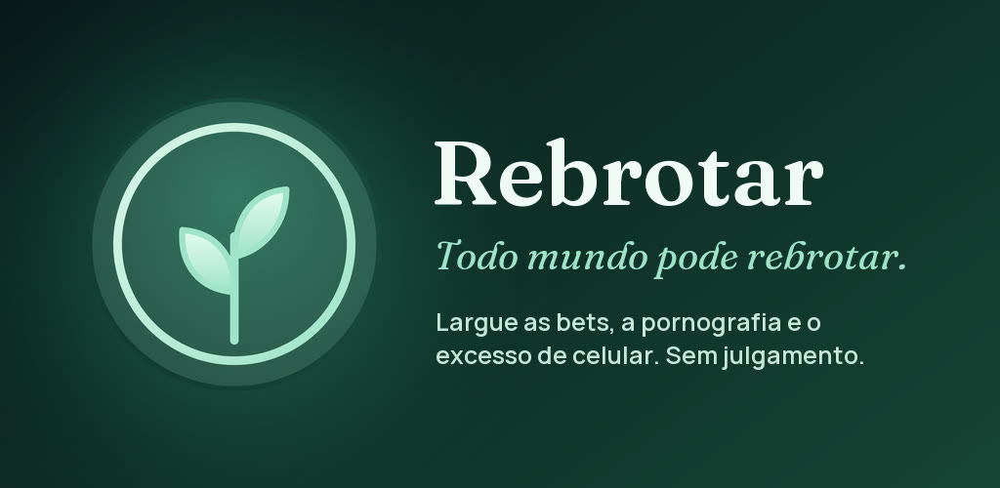
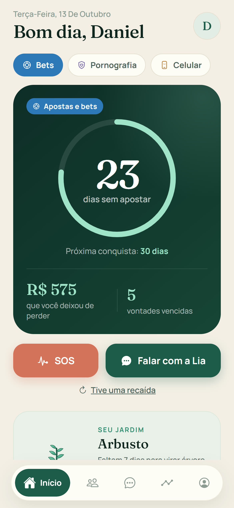
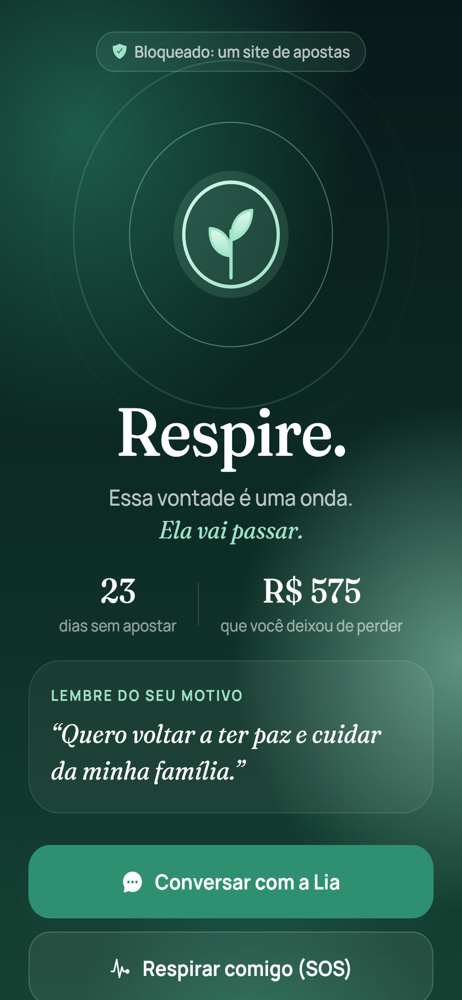
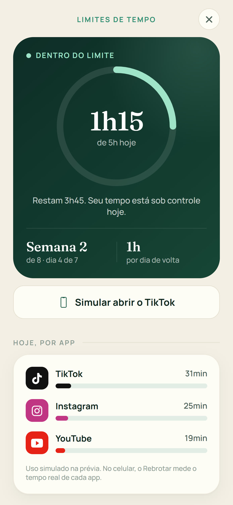
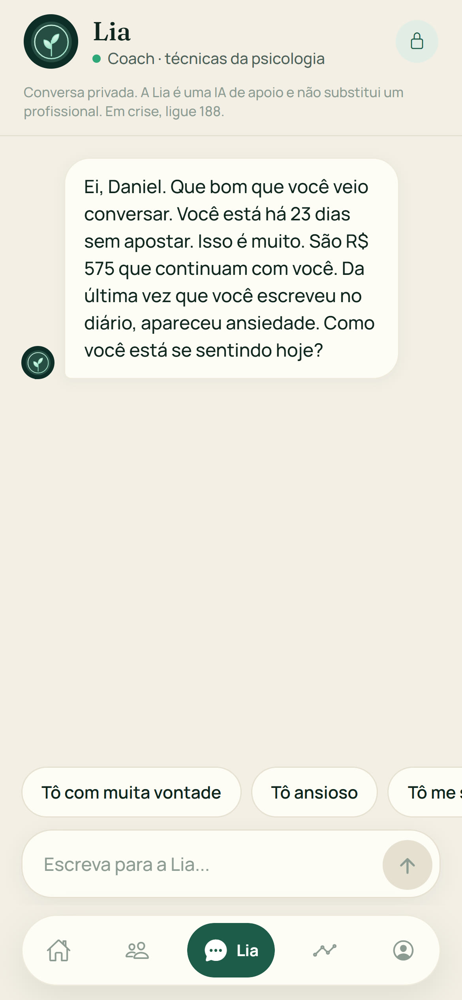
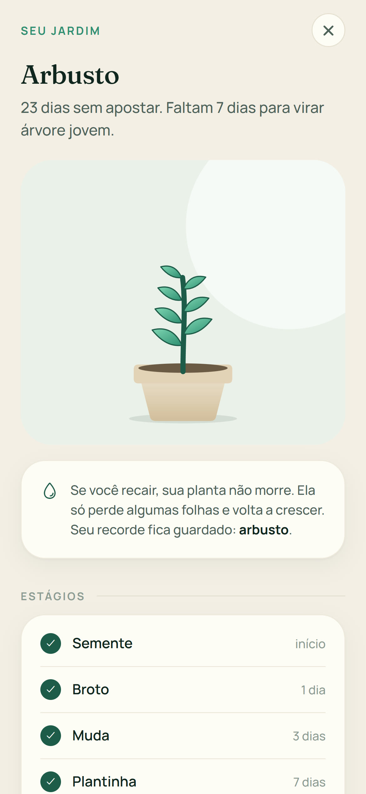
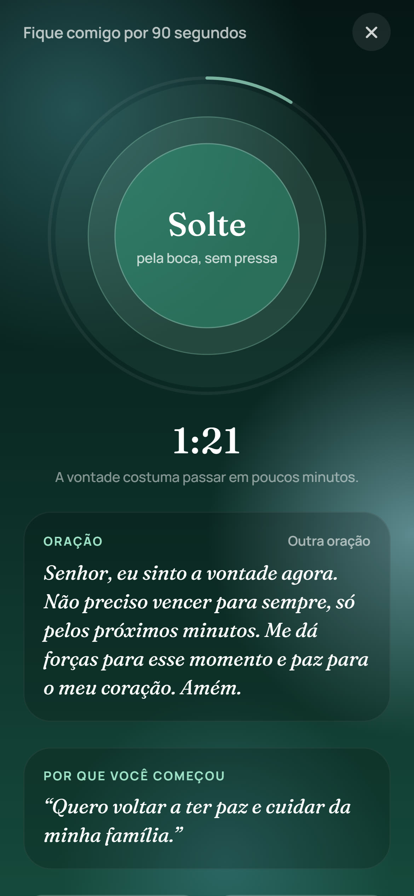

# Rebrotar

**App Android para largar bets, pornografia e o excesso de celular, com acompanhamento diário e sem julgamento.**

**[Baixar na Google Play](https://play.google.com/store/apps/details?id=app.rebrotar)**

Criei o Rebrotar do zero, usando IA como parceira de desenvolvimento, e conduzi o projeto até a publicação na Google Play: regras de produto, testes, política de privacidade, declaração de acessibilidade e revisão da loja.

> **Sobre este repositório.** O código completo do app é privado, porque o produto está em evolução. Aqui ficam a documentação, as telas e trechos de código representativos (as regras de decisão do bloqueio e do limite de tempo, com testes).

## Telas

Telas com dados de demonstração.

| Início | Bloqueio | Limites |
|---|---|---|
|  |  |  |

| Lia | Jardim | SOS |
|---|---|---|
|  |  |  |

## O que ele faz

- **Bloqueio de sites** de apostas e de conteúdo adulto, que funciona mesmo com o app fechado, usando o Serviço de Acessibilidade do Android. Antes de ativar, o app explica o aviso do sistema e pede consentimento.
- **Limite de tempo que desce aos poucos.** A pessoa diz quanto usa hoje e onde quer chegar. O limite desce um degrau por semana, **só quando a semana foi cumprida**. Se não deu, repete, sem castigo. Avisa aos 30 e 5 minutos, protege a noite (23h às 7h) e permite emergências de 5 minutos.
- **Lia, coach de IA.** Conversa na hora da vontade, 24 horas. Diz que é uma IA e não psicóloga, e em situação de crise responde com mensagem fixa e indica o CVV (188), sem passar pela IA.
- **SOS** de respiração guiada, **áudios guiados**, **diário** e um **jardim**: uma planta que cresce com os dias firmes e rebrota depois de uma recaída.
- **Freemium:** contador de dias, SOS, jardim, diário e mensagens do dia são gratuitos. Bloqueio, limites, Lia e áudios fazem parte do plano Premium.

## Decisões de projeto

- **Ajuda, nunca vergonha.** Toda a escrita segue a regra de acolher: recaída não é fracasso, é parte do caminho.
- **Privacidade por padrão.** Sem cadastro, sem e-mail e sem senha. O que a pessoa registra fica no aparelho, e os dados sensíveis são cifrados. As mensagens para a Lia vão a um servidor só para gerar a resposta, e os logs não guardam a conversa.
- **Regras testáveis.** As decisões do bloqueio ficam separadas do código do Android, para poderem ser testadas no computador. Cada proteção importante tem um teste.
- **Menor poder possível.** O app só pede as permissões de que precisa e bloqueia as que não usa (câmera, microfone, armazenamento).

## Como foi construído

| Parte | Tecnologia |
|---|---|
| App | React Native 0.86, Expo, TypeScript, Expo Router |
| Bloqueio nativo | Módulo Android em Kotlin (Serviço de Acessibilidade) |
| Lia | Servidor Node.js no Google Cloud Run chamando o Gemini |
| Áudios guiados | Gerados com ElevenLabs |
| Assinatura | RevenueCat |

Veja [`docs/ARQUITETURA.md`](docs/ARQUITETURA.md) para o desenho completo.

## Trechos de código

Em [`examples/`](examples) há três arquivos reais do projeto:

- `BlockerRules.kt`: regras de decisão do bloqueio, sem nada do Android.
- `BlockerRulesTest.kt`: 10 testes que garantem as proteções.
- `limits.ts`: o plano de limite com redução gradual.

## Custo da IA

Medi o custo da Lia com conversas de teste: cerca de **R$ 0,013 por conversa** de 4 mensagens, o que dá cerca de **R$ 0,27 por usuário ao mês** (estimativa com 20 conversas por mês). O relatório está em [`docs/teste-de-custo-da-lia.md`](docs/teste-de-custo-da-lia.md).

## Privacidade

A [política de privacidade](docs/politica-de-privacidade.md) segue a LGPD e está publicada na página do app.

## Estado atual

- **Publicado** na Google Play e **em evolução**, com mais de 30 versões.
- **Próximos passos:** testar em mais modelos de aparelho, ativar o código ofuscado (R8) no build de release e consolidar a assinatura Premium.
- O app oferece apoio e **não substitui atendimento profissional**. Em crise, ligue 188 (CVV, gratuito, 24 horas).

## Sobre

Criado por **Daniel de Jesus** (estudante de Análise e Desenvolvimento de Sistemas), com IA como parceira de desenvolvimento e revisão, testes e decisões minhas.
[LinkedIn](https://www.linkedin.com/in/daniel-de-jesus-alves/) · [Portfólio](https://dja-portfolio.vercel.app)

> Material publicado para fins de portfólio. Todos os direitos reservados.
